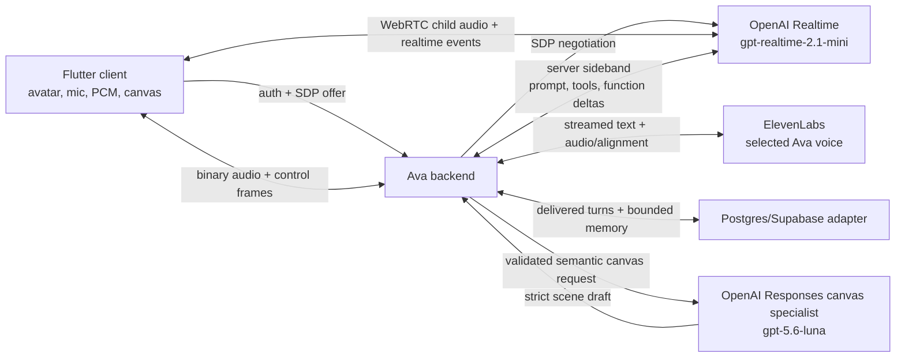
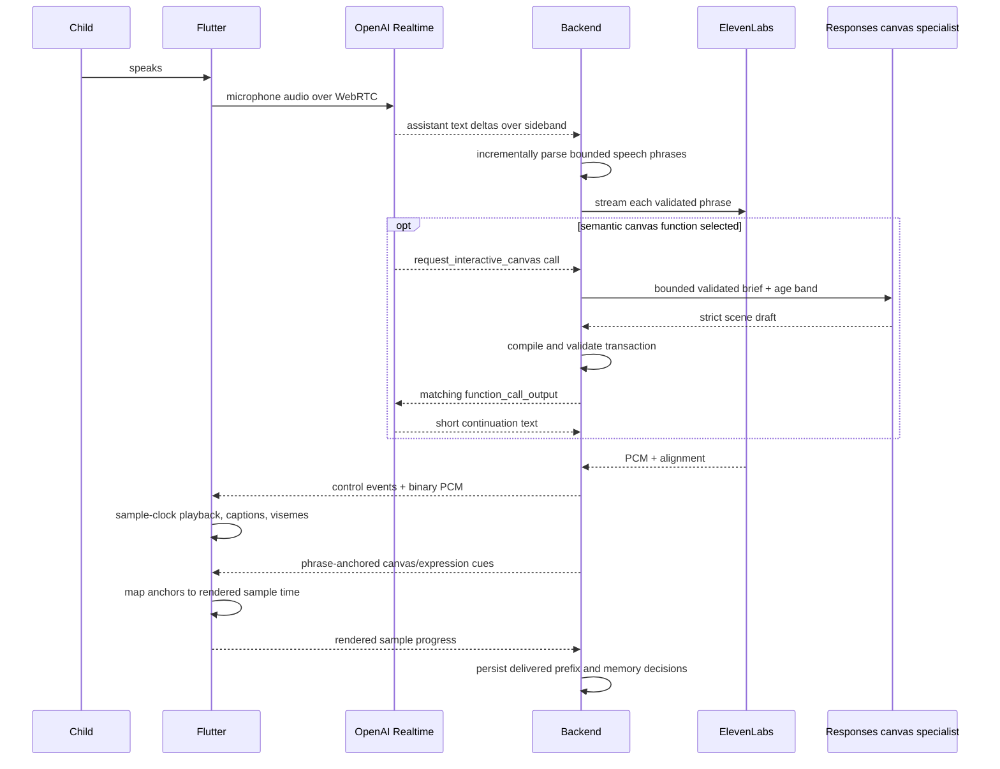

# Ava production architecture

Status: locked target architecture  
Protocol target: v3  
Last reviewed: 2026-08-03

This document describes the production system Ava is moving toward. It replaces
the old lesson-turn, fixed-diagram, activity/progress, and NDJSON performance
plans.

## 1. Product boundary

Ava is a realtime conversational character for children. Natural voice,
personality continuity, interruption, and the sense that the avatar is present
are the critical path. Explanations and drawings are capabilities inside that
conversation, not separate modes.

The runtime must provide:

- live child audio input;
- one consistent Ava personality;
- the selected ElevenLabs voice;
- synchronized captions and stylized lip sync;
- living idle and local touch/3D interaction;
- an optional dynamic vector canvas;
- bounded private memory and a weekly parent recap.

The runtime does not include an activity browser, lessons feed, games, scores,
curriculum state, a general whiteboard editor, arbitrary code execution, or
model-generated skeletal animation.

## 2. System overview



There are two AI/voice provider accounts:

- OpenAI for Realtime conversation and strict on-demand canvas planning;
- ElevenLabs for Ava's production voice.

The database and deployment platform require ordinary infrastructure
credentials, but they are not additional conversation models.

## 3. Why this split

OpenAI Realtime consumes speech directly, understands the conversational
context, performs turn detection, and emits function calls. It is not asked to
generate audio because Ava's approved voice is in ElevenLabs.

ElevenLabs receives only validated assistant speech, streams voice audio and
alignment, and has no authority over memory, personality, canvas behavior, or
avatar movement.

The backend is the control plane. It owns policy, session state, validation,
cancellation, provider credentials, persistence, budgets, and the authoritative
record of what the child actually heard.

Flutter is the realtime presentation plane. It owns microphone capture,
sample-counted playback, avatar interpolation, touch, hit testing, lip sync,
captions, and vector rendering. No network event drives a render frame.

## 4. Connection topology

### 4.1 Session creation

1. Flutter authenticates to the Ava backend.
2. Flutter calls `POST /v3/realtime/sessions`.
3. The backend returns an Ava session ID, protocol version, event-channel URL,
   feature limits, and a short-lived session token.
4. Flutter creates a WebRTC peer connection, attaches a disabled microphone
   track,
   and sends its SDP offer to
   `POST /v3/realtime/sessions/{session_id}/webrtc`.
5. The backend negotiates the offer with OpenAI Realtime using the server API
   key, retains the provider call ID, attaches its sideband WebSocket, and
   returns the SDP answer.
6. During app startup, Flutter applies the answer, opens the authenticated
   bidirectional event WebSocket, sends `clientReady`, and receives the
   validated `listening` phase while the microphone track remains disabled.
7. A microphone tap changes only the existing local track's enabled state.
   Media then flows directly over WebRTC, avoiding bootstrap, SDP, ICE,
   sideband setup, and an extra backend audio hop in the tap path.

The WebRTC peer, OpenAI sideband, and Ava event WebSocket remain open for a
bounded conversation containing consecutive turns. Each turn has a fresh turn
ID, request ID, stream ID, sequence/revision state machine, cancellation scope,
and delivered-memory commit. Muting changes the existing track's enabled state;
only conversation shutdown removes the sender, stops capture, and disposes the
stream. A user pause retains the muted call for at most two minutes so resume
does not renegotiate the provider connection. Expiry, reset, disposal, or a
provider/transport failure releases it and never silently creates a replacement
session.

Flutter tracks microphone intent separately from turn presentation phase.
`planning`, `synthesizing`, `speaking`, and the brief boundary between turns do
not imply that capture was disabled and must never change the microphone button
into a new-session control.

The create request contains only protocol version and the age band derived
locally from the stored DOB. It never contains the child name or exact DOB.
The event token is HMAC-authenticated, short-lived, one-use, scoped to one
opaque Ava session ID, and contains no child data. A claimed, expired, unknown,
or mismatched token fails explicitly; reconnect creates a new Ava session
rather than silently replaying the old turn.

The backend configures the Realtime session over the sideband channel:

- model: backend-configured `gpt-realtime-2.1-mini` initially;
- input: child audio;
- output modality: text only;
- server VAD and interruption enabled;
- one optional semantic canvas function with `tool_choice=auto` and parallel
  calls off;
- versioned Ava prompt harness and bounded context;
- tool choice, output limits, and safety policy controlled server-side.

### 4.2 Ava event WebSocket

The Ava event channel is not a provider socket exposed to Flutter. It is a
versioned application protocol.

Server-to-client control frames are JSON. TTS audio frames are binary and carry
a small binary header or an immediately preceding metadata frame containing:

- protocol version;
- Ava session ID;
- turn ID;
- audio stream ID;
- chunk sequence;
- sample offset;
- byte length.

Client-to-server frames include:

- `clientReady` once per conversation;
- `playbackStarted`;
- periodic bounded `playbackProgress`;
- `playbackStopped`;
- `canvasInteraction`;
- `cancelTurn`.

App lifecycle, audio-route, and explicit close controls remain required release
work; they are not represented as implemented protocol events yet.

Every frame has a maximum size. Unknown frame types, invalid sequence numbers,
or stale revisions are rejected rather than ignored.

## 5. Realtime turn lifecycle



### 5.1 Assistant text and the optional canvas function

Realtime emits natural assistant text and may call one application-owned
function, `request_interactive_canvas`. The provider uses `tool_choice=auto`
with parallel calls disabled. A normal turn contains no function call. The
model decides semantically from the full conversation; application code never
routes on words such as “draw”, “show”, or “diagram”.

Assistant text is authoritative speech. A bounded streaming phrase parser
releases complete sentences immediately and splits an unusually long sentence
only at a safe whitespace boundary. Each released phrase is validated before
ElevenLabs receives it. The parser never depends on JSON property order.

The optional function contains only:

```text
request_interactive_canvas
├── brief
└── interactionGoal (optional)
```

The brief describes purpose, objects, relationships, flow, and essential labels.
It is bounded to 600 characters; the optional interaction goal is bounded to
160 characters. These limits align with the downstream specialist input rather
than forcing ordinary semantic descriptions into an unrealistically small
envelope.
It never contains nodes, coordinates, paths, styles, scene IDs, revisions, SVG,
or executable code. The backend validates the request, invokes the strict canvas
specialist, applies the result to the canonical session scene, and sends exactly
one `function_call_output` with the original call ID. The result is either a
bounded ready summary with scene identity/revision or a bounded rejection.
If Realtime nevertheless emits invalid arguments, the backend returns a
matching rejected `function_call_output`, reports `canvasRejected`, and lets
the spoken turn continue. It never truncates or silently repairs model output.

A successful or rejected optional canvas cannot invalidate already accepted
speech, mute the microphone, or close the persistent conversation. After the
tool result, Realtime produces one short continuation with tool use disabled for
that continuation, preventing recursive canvas calls.

Memory proposals, summaries, avatar movement, and rendering details are not
part of the live model response. The delivered sample ledger is authoritative;
memory compaction happens independently after delivery and never gates speech.

### 5.2 Turn phases

The authoritative backend state machine is:

```text
created
-> connecting
-> listening
-> planning
-> synthesizing
-> speaking
-> completed

Any non-terminal state
-> cancelling
-> cancelled

Any non-terminal state
-> failed
```

Flutter mirrors these states but does not invent transitions. State changes are
idempotent and revisioned.

Connection, microphone intent, physical track state, turn state, canvas state,
and memory state are independent. A failed turn cannot mute the WebRTC track or
change the child's microphone choice. Only a genuine connection/media failure
forces both off.

Entering `speaking` is also the explicit end-of-synthesis boundary for the
current PCM stream. Every `audioChunk` descriptor and its immediately following
binary frame must arrive while the turn is `synthesizing`. Flutter rejects
late audio after `speaking`; this lets native playback accept `finish` exactly
once without racing a later append.

## 6. Voice, alignment, and lip sync

The first production format is signed 16-bit mono PCM at 24 kHz. It is larger
than compressed audio but keeps playback accounting and lip-sync timing
deterministic. Opus is a later optimization only after sample-accurate timing
is proven across route changes.

The backend keeps one ElevenLabs input-streaming WebSocket active for the
current Ava turn:

1. send the selected voice/model/settings once;
2. send validated text as semantic chunks;
3. flush at segment boundaries;
4. decode provider audio;
5. normalize alignment to text offsets and audio sample ranges;
6. send binary PCM and normalized alignment to Flutter;
7. close or cancel immediately on terminal state.

Character timing is not called phoneme timing. A deterministic alignment stage
converts text/audio alignment into the VRM's supported viseme timeline. It may
use a local/server phonemizer or forced aligner, but not another generative
model. Unsupported or low-confidence phonemes resolve to a neutral mouth shape
through an explicit mapping, not an unlabeled fallback.

Flutter schedules:

- audio from the native rendered-sample clock;
- Ava captions from speech text offsets;
- visemes from normalized phoneme/sample ranges;
- expression/gaze/canvas cues from phrase anchors mapped to the same ranges.

The current restrained avatar baseline remains: living idle, blink, eye
contact, subtle expression, and lip sync. Touch remains independent.

## 7. Barge-in and delivered speech

External TTS makes interruption accounting essential.

When Realtime reports that the child started speaking:

1. the backend emits `interruptRequested`;
2. Flutter applies a very short click-free fade and stops queued PCM;
3. Flutter reports the final rendered sample index;
4. the backend cancels the Realtime response and ElevenLabs stream;
5. alignment maps the sample index to the last delivered text offset;
6. pending canvas actions and unsaid segments are discarded;
7. only the delivered Ava prefix is written to the conversation ledger.

Provider conversation state is reconciled so a later response does not assume
the unheard suffix was spoken. The backend deletes/replaces the interrupted
provider item when the Realtime API permits it; otherwise the next model
context explicitly states the delivered prefix and interruption. The backend
ledger remains authoritative in either case.

## 8. Dynamic vector canvas

### 8.1 Representation

The specialist produces declarative scene content, never markup. The backend
owns the canonical scene ID and revision, then compiles the content into an
`AvaCanvasScene` transaction:

```text
scene
├── logicalSize
├── theme
├── state variables
├── nodes by stable ID
└── ordered transactions
```

Initial node kinds:

- `group`;
- `text`;
- `line`;
- `arrow`;
- `circle`;
- `ellipse`;
- `rect`;
- `polygon`;
- `polyline`;
- `path`.

The `path` node uses a strict SVG-compatible path-data grammar. Commands,
coordinates, length, bounds, and nesting are validated. XML and SVG elements
are not accepted.

Transactions:

- `create`;
- `update`;
- `delete`;
- `reveal`;
- `focus`;
- `animate`;
- `clear`.

Allowed local interaction bindings:

- explore a visible stage by selecting it, revealing up to four detail nodes,
  dimming the previous stage, and pulsing up to four declared connectors;
- tap/select;
- toggle;
- reveal;
- drag inside a bounded region;
- set a bounded scalar or enum value;
- reset;
- submit a typed outcome.

There are no scripts or arbitrary expressions. Interaction effects are selected
from a small declarative operation vocabulary and target stable scene/state
IDs.

Explore's visual effects, reveal, toggle, drag, state changes, and reset are
executed entirely in Flutter. `explore`, `select`, and `submitOutcome` are
semantic conversation events.
Flutter sends their scene ID, scene revision, interaction revision, and binding
ID; the backend derives the actual label or declared value from the canonical
validated binding. Raw coordinates, client labels, and free-form outcome text
never enter model context.

### 8.2 Rendering

Flutter validates a transaction against the current scene revision, applies it
atomically, and renders vector primitives through a custom painter/render
object. This gives direct hit testing and smooth local animation. An SVG
serializer may be used for golden tests, accessibility snapshots, or export,
but the runtime does not pass model text to `SvgPicture.string`.

Initial scenes use deterministic app-owned stagger delays. The specialist may
also declare bounded slow repeating motion on grouped visual objects with an
explicit pivot; Flutter owns every rendered frame. Explore interactions
retarget currently running local tracks, then update selection, explanation,
and connector feedback atomically. Repeating an interaction restarts its small
local response without a provider call. A later voice turn may revise the
complete canonical scene; stable node and interaction IDs preserve local state.

The renderer enforces:

- clipped logical viewport;
- finite numeric values;
- bounded nodes and path commands;
- allowlisted typography plus validated six-digit colors, bounded linear and
  radial gradients, soft shadows, and authored paint order;
- maximum text length and line count;
- maximum transforms and animation duration;
- no external resources;
- WCAG-aware contrast checks where applicable;
- semantic labels for interactive nodes;
- deterministic Reduce Motion behavior.

The specialist's coordinates and node order are authoritative composition.
Flutter measures and renders text with the same `TextPainter`, but never moves
authored labels or reorders elements by primitive kind. Pointer geometry
expands compact controls to a minimum 44-by-44 physical points after applying
the actual viewport scale, without changing their visible shape.

### 8.3 Synchronization

The backend compiles the specialist draft into a complete transaction, applies
the same structural scene validator used by Flutter, and emits a sample-clock
canvas cue at a stable segment boundary. Provider parsing rejects unknown
fields, invalid references, unsafe interaction state, unbounded data, and
unsupported primitives. A deterministic quality gate then checks entity
coverage, composition, text collision, interaction targets, connector
attachment, and authored palette. One bounded repair may be requested before
rejection. Realtime speech must stand on
its own and must not promise that a visual appeared. Invalid, refused,
timed-out, or over-budget canvas work emits `canvasRejected`; speech and memory
delivery continue and the panel stays closed.

For a revision, the specialist receives the compact brief plus the complete
bounded current draft and revision. It returns a complete desired scene while
preserving stable node IDs. It never authors the canonical scene ID. The
backend computes create/update/delete operations, owns scene identity and the
next revision number, validates the result atomically, and sends only that
transaction. Every specialist scene contains at least one validated bounded
interaction, so an accepted visual cannot be inert. Realtime receives a compact
semantic view of the active scene and the last validated semantic interaction,
never its geometry.

### 8.4 Session ownership and interaction revisions

Canvas state belongs to one persistent realtime conversation session, not to a
child profile and not to the turn that first created it. The backend allocates
one canonical `CanvasSessionState` with the coordinator and discards it when
that WebRTC/session closes. Flutter clears its local scene when a new session
is bootstrapped, while retaining it across all turns of the same session.

`canvasInteraction` is therefore a session control. It carries session ID,
scene ID, scene revision, interaction revision, and binding ID; it does not
carry or depend on a speaking turn ID. Local reveal, toggle, reset, state, and
drag actions do not emit this event. For `explore`, `select`, and
`submitOutcome`, the
backend resolves the binding against its canonical scene and installs the
resulting bounded semantic context for the next response without starting a
provider response.

Scene revisions change only through validated canvas transactions. Interaction
revisions increase independently as the child acts on the scene. A stale scene,
revision, binding, or replay emits the non-terminal `interactionRejected`
session event. That warning advances protocol ordering but cannot fail a turn,
close the event socket, stop speech, or change microphone intent.

## 9. Memory and persistence

The existing persistence adapter can be evolved rather than tied permanently
to Supabase. The logical store needs:

- authenticated installation/parent subject;
- Ava session metadata;
- child turn summary or transcript when available;
- generated Ava segments;
- delivered text range and terminal status;
- validated stable-memory proposals with provenance;
- current-session summary;
- weekly topic/event summaries;
- reset tombstone/audit metadata.

Raw audio is not persisted by default. Raw transcripts are retained only for a
defined short window and are excluded from normal logs. Long-term memory uses
compact typed summaries.

The provider receives:

- derived age band;
- short delivered-turn context;
- approved stable interests/preferences;
- current-session summary;
- current canvas state only when needed.

It does not receive the child's name, exact date of birth, database IDs,
location, or parent account details.

Conversation reset deletes conversation turns, summaries, and derived memory
for that profile. It preserves the profile and app settings. Reset must cover
both device cache and backend persistence and return a completion revision;
local success without cloud success is an error.

## 10. Authentication and child privacy

The current loopback authenticator is development-only. Production needs:

- a parent/installation identity flow;
- short-lived backend access tokens;
- refresh/revocation;
- per-subject and per-device rate limits;
- App Attest/DeviceCheck or equivalent abuse protection on Apple platforms;
- deletion/export procedures;
- a documented retention schedule and parental consent flow;
- regional/privacy review before collecting child data.

The existing server-side Supabase adapter is acceptable for the first
deployment if authentication and row ownership are completed. The service-role
key remains backend-only. A public client key, if used by Supabase Auth, is not
a model-provider secret.

## 11. Safety

Safety is layered:

- prompt and relationship policy;
- bounded function schema;
- input/output safety classification available through the same OpenAI
  account when required;
- backend rules for prohibited memory and canvas content;
- provider safety/refusal events;
- child-safe error and redirect language;
- offline red-team and regression suites;
- parent-accessible reset and data controls.

The app must not imply that Ava is human, encourage secrets or exclusivity, or
replace trusted adults. Immediate-danger responses should be calm and direct.
Exact hotline content is locale-sensitive and must come from an approved
locale-aware source when implemented.

## 12. Failure behavior

Failures are typed and visible in telemetry and UI state:

- authentication/authorization failure;
- WebRTC negotiation or sideband failure;
- provider rate limit/timeout/unavailable;
- malformed or unsafe tool arguments;
- ElevenLabs connection/audio/alignment failure;
- protocol sequence/revision failure;
- canvas validation/render failure;
- persistence failure;
- playback/route failure;
- cancellation timeout.

There is no switch to platform TTS, canned model response, fixed diagram, or
different voice. Optional components can fail independently:

- invalid canvas: valid speech may continue, `canvasRejected` is emitted, and
  the panel stays closed;
- memory write failure: emit non-terminal `memoryPersistenceFailed`, then the
  normal spoken terminal event; the app exposes a persistent retry-required
  memory state without failing speech or media;
- weekly recap failure: existing recap remains marked stale.

## 13. Latency and backpressure

Measure at least:

- microphone-to-VAD-end;
- VAD-end-to-first assistant-text delta;
- first delta-to-first valid phrase;
- valid segment-to-first TTS byte;
- first TTS byte-to-first rendered sample;
- speech/canvas cue drift;
- interruption-to-silence;
- total turn time.

Targets are set after device measurements, not guessed in code. The first
auditable goal is a median first-audio latency near natural conversational
turn-taking and a consistently short interruption-to-silence time.

All queues are bounded:

- Realtime text/tool-event buffer;
- TTS text queue;
- decoded PCM ring buffer;
- outbound event queue;
- canvas preload queue;
- persistence retry queue.

Backpressure pauses upstream text flushing or cancels the turn. It never grows
memory without bound.

## 14. Cost controls

- Default to the mini Realtime model.
- Keep the stable prompt/tool prefix identical to maximize provider caching.
- Keep responses naturally short.
- Do not send avatar frames, touch events, or render state to a model.
- Call the canvas specialist only after Realtime semantically selects
  `request_interactive_canvas`.
- Cap audio duration, silence, response characters, canvas complexity, session
  length, and daily account spend.
- Cancel provider work immediately on disconnect or interruption.
- Record per-turn provider usage and cost estimates by model/voice.
- Gate live integration/evaluation tests behind an explicit spend flag.

Current provider prices and model availability must be read from official
documentation at deployment time; do not bake historical prices into product
logic.

## 15. Observability

Structured telemetry uses session/turn/request IDs and phase timings. It may
include:

- model/voice configuration identifiers;
- token/audio usage;
- segment and canvas counts;
- validation error codes;
- queue depth/high-water marks;
- playback underruns and cue drift;
- cancellation and reconnect results;
- provider request IDs.

It must not include API keys, raw audio, exact birth dates, full child names,
or unrestricted transcript text. Development transcript logging is opt-in,
redacted, and disabled in release builds.

The development backend also writes rotating JSON Lines diagnostics to
`backend/.logs/ava-backend.jsonl` (or `AVA_DEVELOPMENT_LOG_PATH` when
configured). Every turn failure carries a safe `failureId`, `component`,
session ID, and turn ID so an on-screen failure can be correlated without
showing child data. Canvas rejection and memory persistence warnings are turn
events and must not close or mute the persistent conversation; only a genuine
WebRTC, event-WebSocket, or media failure may tear it down.

`/health/ready` reports the running build version and instance ID, a source
revision/currentness check, protocol version, Realtime prompt version,
Realtime tool-contract version, and canvas-specialist prompt version. A source
tree changed after process startup reports `503 stale`, making an old backend
process explicit instead of silently serving an obsolete prompt or schema.

## 16. Deployment configuration

Two provider secrets are required only for live provider integration:

- `AVA_OPENAI_API_KEY`;
- `AVA_ELEVENLABS_API_KEY`.

Production also needs non-provider configuration:

- exact ElevenLabs voice ID and model ID;
- documented voice commercial-use approval;
- database URL and server credential;
- auth signing/verification configuration;
- safety hash secret;
- allowed origins/hosts;
- rate and spend limits;
- telemetry destination and redaction policy.

No key is needed to build the protocol, fake session coordinator, canvas,
renderer, state machine, cancellation tests, or local playback fixtures.

## 17. Authoritative external references

- [OpenAI Realtime guide](https://developers.openai.com/api/docs/guides/realtime)
- [OpenAI Realtime function calling](https://developers.openai.com/api/docs/guides/realtime-conversations#function-calling)
- [OpenAI Realtime server controls and sideband](https://developers.openai.com/api/docs/guides/realtime-server-controls)
- [OpenAI gpt-realtime-2.1-mini](https://developers.openai.com/api/docs/models/gpt-realtime-2.1-mini)
- [OpenAI gpt-5.6-luna](https://developers.openai.com/api/docs/models/gpt-5.6-luna)
- [OpenAI API pricing](https://developers.openai.com/api/docs/pricing)
- [ElevenLabs realtime TTS WebSocket guide](https://elevenlabs.io/docs/eleven-api/guides/how-to/websockets/realtime-tts)
- [ElevenLabs input-streaming TTS API](https://elevenlabs.io/docs/api-reference/text-to-speech/v-1-text-to-speech-voice-id-stream-input)
