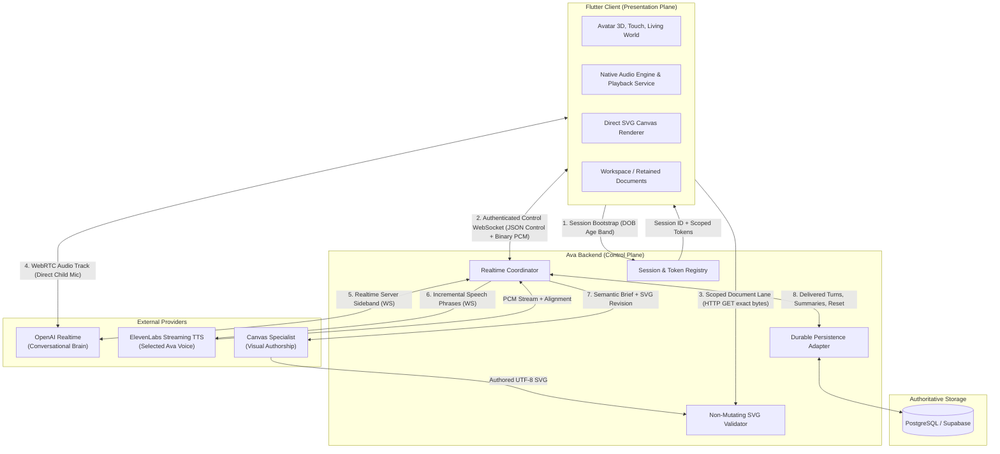
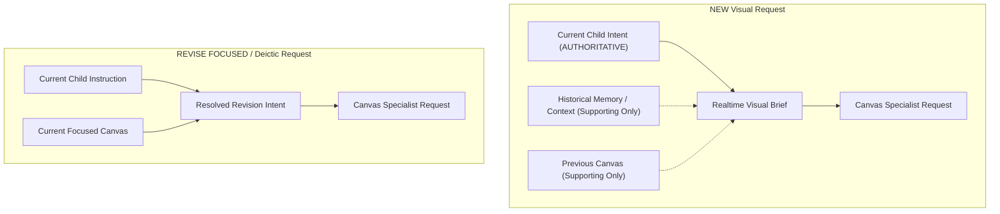
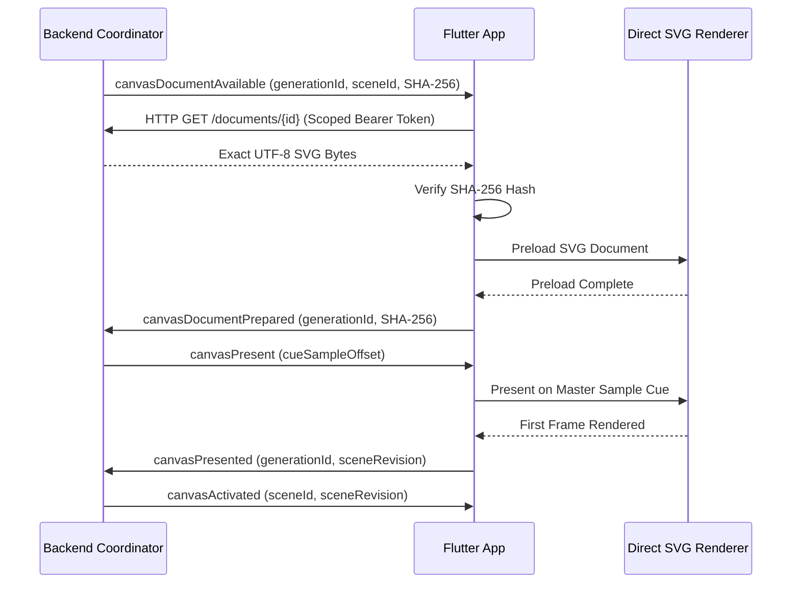

# Ava Production Architecture

Status: Locked target architecture
Protocol target: v4
Audience: Architecture decisions, forensic analysis, coding agent implementation, and invariant review.

This is the authoritative architectural source of truth for the Ava repository.
It supersedes all prior implementation plans, lesson-based designs, and fixed
diagram schemes.

---

## 1. Product Boundary

Ava is an avatar-first, realtime conversational character for children on iPhone
and iPad; macOS is the primary development environment. Natural, gentle,
low-latency conversation and a consistent, trusted personality are the primary
value. Ava can explain, illustrate, and draw when helpful, but ordinary
conversation is never forced into a structured lesson.

### Core Experience
- **Direct Engagement:** The application opens directly to Ava facing the child.
  There is no splash screen delay, navigation bar, or permanent dashboard.
- **Minimal Chrome:** Only a subtle settings control at top right and a
  microphone toggle at bottom left appear over the view. Captions are optional
  and rendered transparently near the lower edge.
- **Dynamic Canvas:** The canvas is hidden unless a visual explanation helps.
  When active, it occupies the lower half of the screen while Ava remains
  visible and expressive in the upper half.
- **Atmosphere and Avatar:** A calm visual base near `#BFC7C7` with a local
  day/night background and interactive touch elements (sun, moon, clouds, stars).
  Rendering targets smooth 60/120 Hz, interpolated locally; network events never
  directly drive animation frames.
- **Settings Scope:** Limited strictly to child name, date of birth (DOB),
  captions toggle, factual weekly recap, and conversation reset. Developer,
  provider, model, or motion controls are excluded.

### Non-Goals and Prohibitions
Ava does not contain:
- Feeds, tabs, activity catalogs, puzzles, scores, or streak counters;
- Curriculum modes, mastery tracking, or teacher/chat mode toggles;
- A generic freeform whiteboard editor or annotation system;
- Model-generated executable code (JavaScript, HTML, or WebAssembly);
- Model-generated raw skeletal animations or unconstrained motion scripts.

---

## 2. Core Architecture and Topology



### Communication Lanes
1. **WebRTC Media Lane:** Child microphone audio flows directly between Flutter
   and OpenAI Realtime over WebRTC. The backend negotiates the SDP offer/answer
   and retains provider call ownership, keeping media off intermediate backend hops.
2. **Realtime Sideband Lane:** A persistent WebSocket between the Ava backend
   and OpenAI Realtime. Carries session configuration, prompts, tool definitions,
   server VAD signals, assistant text deltas, and semantic function calls.
3. **Ava Event WebSocket:** Authenticated bidirectional application channel
   between backend and Flutter. Carries versioned JSON control frames and binary
   24 kHz 16-bit mono PCM frames. SVG document bytes never share this ordered
   audio lane.
4. **Canvas Document Lane:** Independently authenticated HTTP endpoint
   (`GET /v4/realtime/sessions/{sessionId}/canvas/documents/{generationId}`).
   Flutter fetches validated SVG bytes using a short-lived bearer token scoped to
   the session, generation, candidate, and content hash with `Cache-Control: no-store`.
5. **TTS Input-Streaming Lane:** A dedicated streaming WebSocket between the Ava
   backend and ElevenLabs for each complete, validated speech phrase, returning
   raw PCM chunks and exact character/sample alignments.

---

## 3. Authority and Ownership Model

### Subsystem Responsibilities
- **OpenAI Realtime:** Owns conversational reasoning and current semantic intent.
  Consumes child audio, detects turns via server VAD, determines whether a
  visual helps, selects tools semantically, and emits assistant speech text.
  OpenAI audio generation is disabled; Realtime has no authority over Ava's voice.
- **ElevenLabs:** Owns production voice synthesis and audio alignment only.
  Operates on bounded speech phrases released by the backend. Has no semantic
  authority over personality, memory, canvas, or avatar movement.
- **Canvas Specialist:** Owns visual composition and SVG authorship only.
  Receives a single resolved semantic brief; does not arbitrate child intent or
  conversational state.
- **Backend (Control Plane):** Owns lifecycle, session state, safety policy,
  deterministic validation, cancellation, provider credentials, persistence,
  budgets, and the authoritative record of delivered speech.
- **Flutter / Device (Presentation Plane):** Owns microphone capture intent,
  sample-accurate playback, avatar rendering and touch interaction, direct SVG
  rendering, element hit testing, local continuous manipulation, and the local
  canvas workspace. No network event directly drives an animation frame.

### Hierarchy of Semantic Authority
A rigid authority hierarchy prevents split-brain reasoning:



1. **For a NEW Explicit Visual Request:** Current child intent is strictly
   authoritative. Historical memory, previous canvas documents, old turns, and
   past interactions are supporting context only. The Realtime visual brief may
   elaborate structure, relationships, and labels, but must never override or
   substitute the child's explicit topic.
2. **For a REVISE FOCUSED or Deictic Request:** The combination of
   `CURRENT CHILD INSTRUCTION` and `CURRENT FOCUSED CANVAS` together define the
   request.
3. **No Keyword Routing:** Tool selection is semantic and contextual within
   Realtime (`tool_choice=auto`). Application code never dispatches on trigger
   words (e.g., "draw", "show").
4. **Memory is Never Intent:** Memory provides historical background; it never
   overrides an explicit in-session request.

### Asynchronous State and Identity Fencing
Every piece of mutable asynchronous state has exactly one authoritative owner:

| Entity | Authoritative Owner | Scope / Lifetime |
|---|---|---|
| Conversation Session | Backend Session Registry | Persistent across turns; bounded by expiry/close |
| WebRTC Peer & Mic Track | Flutter Media Engine | Persistent across turns; destroyed only on session close |
| Turn Lifecycle | Backend Realtime Coordinator | One child utterance to speech completion/interruption |
| Provider Input Item | OpenAI Realtime | One committed provider conversation input item associated with one child utterance/transcription lifecycle |
| Speech Synthesis & Protocol Delivery | Backend Speech Pipeline | Parses assistant text, streams ElevenLabs TTS requests, delivers audio protocol frames, accounts for delivered prefix |
| Client Presentation State | Flutter Presentation Engine | Tracks currently accepted turn/stream presentation identity, viseme and caption presentation state |
| Rendered Audio Sample Clock | Native Audio Engine (reported via Playback Service) | Monotonically counted audio samples per stream/turn; master presentation clock |
| Canvas Generation | Backend Canvas Job Coordinator | One specialist execution; identified by `generationId` |
| Canvas Candidate Lifecycle | Backend Canvas Session State | Mutable staging, preparation, cue scheduling, and activation of candidate document; identified by generation and content-hash tuple |
| Canvas Scene & Revisions | Backend Canvas Workspace | Persistent session state; monotonic scene revision integer |
| Local Canvas Workspace & Focus | Flutter Canvas Session Host | User-facing visual state; retains up to 10 scenes across turns |
| Client Interaction Sequence | Flutter Canvas Controller | Monotonic interaction sequence incremented per user binding interaction on active scene |
| Canonical Interaction Record | Backend Canvas Workspace | Validates sequence monotonicity and hashes; records canonical interaction into active scene history |
| Memory Commit Epoch | Authoritative Memory Store | Increments per successful authoritative conversation reset |

**Identity Rules:**
- Consumers may retain an owner's identity token, but must never invent shadow
  counters or assume parallel components remain synchronized.
- Stale callbacks, late network packets, and cancelled tasks from older
  identities are dropped; they must never mutate current state.
- The latest intentional child action supersedes obsolete pending work; rapid
  inputs must not build an execution backlog.

---

## 4. Realtime Conversation Lifecycle

### Session Creation and Startup
1. Flutter authenticates to the Ava backend.
2. Flutter requests session creation (`POST /v4/realtime/sessions`) providing the
   protocol version and an age band derived locally from stored DOB (exact DOB
   and child name are never transmitted).
3. Backend registers the session, generates an HMAC-authenticated session token,
   and allocates WebRTC / WebSocket endpoints.
4. Flutter initializes a WebRTC peer connection with a disabled local audio track
   and submits its SDP offer (`POST /v4/realtime/sessions/{id}/webrtc`).
5. Backend negotiates the offer directly with OpenAI Realtime, retains the
   provider call ID, connects the sideband WebSocket, and returns the SDP answer.
6. Flutter opens the Ava event WebSocket, issues `clientReady`, and transitions
   to `listening` with capture disabled.
7. Tapping the microphone toggles the existing track's enabled state; audio flows
   immediately over WebRTC without connection setup or SDP renegotiation.

### Muting, Pausing, and Persistence
- **Muting:** Only toggles the local WebRTC track enabled state. WebRTC, sideband,
  and event channels remain fully active.
- **Warm Window:** As an explicit product decision, a paused or muted conversation
  is held open for up to two minutes to allow immediate, zero-latency resumption.
- **Shutdown:** Explicit conversation reset, app disposal, or fatal connection
  failure releases the provider call, terminates capturing, closes WebSockets,
  and clears transient memory.

### Turn State Transitions

```text
created -> connecting -> listening -> planning -> synthesizing -> speaking -> completed
               |            |            |             |            |
               +------------+------------+-------------+------------+---> cancelling -> cancelled
               |
               +---> failed
```

- States are strictly owned by the backend Realtime Coordinator; Flutter mirrors
  state without synthesizing transitions.
- Microphone intent, turn phase, canvas lifecycle, and memory persistence are
  independent. A failed turn or canvas rejection cannot alter microphone intent
  or mute the child.

---

## 5. Speech, TTS, Playback, and Interruption

### Phrase Parsing and Streaming Synthesis
- Realtime emits natural assistant text deltas over the sideband.
- The streaming phrase parser splits incoming text into complete grammatical
  phrases at punctuation boundaries (falling back to whitespace for sentences
  exceeding length bounds).
- Each validated phrase immediately opens an ElevenLabs input-streaming
  WebSocket. Audio is synthesized and streamed as 24 kHz mono 16-bit signed PCM.
- The backend never waits for full turn completion before initiating speech.

### Presentation Clock
- Synthesized audio chunks are sent over the Ava event WebSocket with metadata
  specifying stream ID, chunk sequence, sample offset, and byte length.
- The native audio engine maintains the master rendered-sample clock, reported
  back through the playback service.
- Captions, VRM visemes (mapped deterministically from provider character/phoneme
  alignments), avatar expressions, and canvas presentation cues are scheduled
  strictly against the rendered-sample clock. Wall-clock timers are prohibited
  on the presentation path.

### Interruption (Barge-In)
When the child speaks while Ava is talking:
1. Realtime server VAD detects speech; the backend emits `interruptRequested`.
2. The client immediately stops queued audio cleanly and quickly, and reports
   the exact final rendered sample index.
3. Backend cancels the active Realtime response and closes the in-flight
   ElevenLabs stream.
4. Backend alignment maps the final rendered sample index to the exact text
   offset heard by the child.
5. Only the confirmed delivered prefix is written to the authoritative
   conversation ledger. Unheard text is dropped.
6. The backend reconciles provider conversation history (truncating the item via
   Realtime API where supported or injecting explicit delivered-prefix context
   on the subsequent turn) so future turns never assume unheard text was heard.
7. Interruption is idempotent; late or stale audio frames cannot revive an
   interrupted turn.

---

## 6. Canvas Semantic Intent

### The Canvas Function Contract
Realtime has access to one semantic canvas creation tool:
```json
{
  "name": "request_interactive_canvas",
  "description": "Request a visual canvas when a drawing, diagram, or interactive visual directly helps the child understand.",
  "parameters": {
    "type": "object",
    "properties": {
      "operation": {
        "type": "string",
        "enum": ["new", "reviseFocused"],
        "description": "Use new for a separate visual or different concept. Use reviseFocused only to modify the current focused visual."
      },
      "brief": {
        "type": "string",
        "maxLength": 1000,
        "description": "Conversational purpose, essential objects, relationships, flow, labels, and interaction intent. Never include coordinates, SVG, styles, or code."
      },
      "interaction_mode": {
        "type": "string",
        "enum": ["none", "explore", "select", "steps"],
        "description": "none for static visual, explore for tap/direct manipulation, select for choosing options, steps for ordered progression."
      }
    },
    "required": ["operation", "brief", "interaction_mode"]
  }
}
```

### Decoupled Execution
1. Realtime calls `request_interactive_canvas`.
2. The backend validates arguments, reserves budget/queue slots, and returns an
   immediate `function_call_output` containing `status: "accepted"` and a new
   `generationId` (or `status: "rejected"` with a bounded reason).
3. Realtime immediately generates a short spoken continuation with tool calls
   disabled, explaining what it is drawing. Realtime never waits for visual
   generation to finish.
4. If the child changes their mind before the canvas is ready, Realtime can invoke
   `cancel_interactive_canvas` to abort pending generation cleanly.

---

## 7. Canvas Generation and Validation

### Specialist Execution
- Model: Configured specialist model (`gpt-5.6-terra` medium reasoning effort in
  current deployment).
- Receives: Generation ID, age band, client render profile (viewport bounds,
  touch target scales), semantic brief, interaction mode, and (for revisions)
  the complete, unmodified active SVG document.
- Returns: Exactly one complete UTF-8 encoded SVG document. Reasoning traces may
  coexist in provider metadata, but Markdown wrappers, commentary, or multiple
  payloads are strictly invalid.

### Non-Mutating Validation
The backend validates the SVG string without mutating it:
- **Canonical Encoding:** The text is encoded to UTF-8 bytes exactly once. No
  pretty-printing, whitespace stripping, entity expansion, or XML reserialization
  is permitted. The resulting bytes and their SHA-256 hash are canonical.
- **Safety Inspection:** A hardened parser inspects the document structure. It
  strictly rejects DTDs, external entities, `<script>`, inline event handlers
  (`onclick`, etc.), `<foreignObject>`, external URLs, CSS `@import`, and
  unsupported CSS filters.
- **Complexity and Resource Bounds:** Checks maximum byte size (384 KB limit),
  path node complexity, nesting depth, and reference graphs (rejecting cycles or
  exponential expansions in `<use>`, `clipPath`, or `mask`).
- **Semantic Metadata Extraction:** Inspects semantic binding attributes, stable
  element IDs, and direct-child `<title>` and `<desc>`. Generates a deterministic,
  hash-bound interaction and accessibility manifest.
- **Single Repair Boundary:** If validation fails, at most one repair call may
  be made to the specialist containing deterministic error diagnostics. If the
  repair fails, the canvas is rejected.

---

## 8. Canvas Workspace, Focus, and Presentation

### Generation Lifetime vs. Speech Lifetime and Panel Presentation
Accepted canvas generation is completely independent from speech presentation
and client panel visibility:
- Normal speech barge-in does **not** cancel accepted canvas work.
- **Panel Dismiss $\neq$ Canvas Semantic Cancel:** Dismissing or hiding the
  canvas panel on the client is purely local presentation state. Closing the
  panel does not delete an active scene and does not cancel pending specialist
  generation. A dismissed panel may be reopened at any time while generation
  proceeds or after presentation completes.
- Accepted canvas work terminates only upon:
  1. Explicit semantic cancellation via Realtime tool call
     (`cancel_interactive_canvas`);
  2. Supersession by a newer accepted canvas generation;
  3. Provider timeout, validation failure, or presentation failure;
  4. Conversation session shutdown or reset.

### Document Delivery and Activation Handshake


1. **Availability:** Backend emits `canvasDocumentAvailable` over the control socket.
2. **Independent Fetch:** Flutter retrieves the document over the dedicated
   HTTP lane and verifies its SHA-256 hash against the control frame.
3. **Preload:** Flutter preloads the direct renderer and responds with
   `canvasDocumentPrepared`.
4. **Cue Scheduling:** The backend maps a speech phrase anchor to a rendered
   audio sample offset and issues `canvasPresent`.
5. **Presentation:** Flutter displays the candidate when the audio clock hits the
   cue (or immediately if already passed) and sends `canvasPresented`.
6. **Activation:** The backend marks the revision canonical and sends
   `canvasActivated`. If presentation fails or times out, the prior active scene
   is preserved.

### Durable Recovery, Canonical Session Workspace, and Focus Decoupling
- **Durable Recovery Authority:** Flutter persists the complete bounded retained
  workspace and immediate user-facing focus (up to 10 scenes). On startup this
  state is authenticated recovery/bootstrap input, not permanent canonical
  authority after backend adoption.
- **Canonical Session Authority:** Before WebRTC negotiation, Flutter sends the
  ordered metadata-only workspace manifest to
  `PUT /v4/realtime/sessions/{sessionId}/canvas-workspace`, then restores the
  focused scene's exact SVG through the existing document lane. Once adopted,
  the backend owns canonical order, `workspaceEpoch`, `workspaceRevision`, and
  creation/modification sequences; Flutter verifies and durably persists its
  exact structural mutations.
- **Immediate Local Presentation:** Switching retained scenes is an immediate
  local visual action on the device that must never freeze, block, or wait for
  active Ava speech, TTS synthesis, or model readiness.
- **Independent Semantic Synchronization:**
  ```text
  User selects retained scene
    -> Device visually focuses it immediately
    -> Durable local focus state updates
    -> Asynchronous notification updates backend Realtime context
    -> Latest focus revision wins
  ```
- **Navigation Readiness:** Deterministic next/previous/first/last navigation is
  unavailable until the complete manifest is accepted. Metadata-only scenes are
  hydrated lazily through the existing exact-hash focus/content path and never
  derive ordering from focus arrival.
- **Grounding Invariant:** While local UI remains instantly responsive, before a
  subsequent reasoning action uses canvas context (e.g., the child asking "what is
  that part?"), the latest accepted focus must be authoritative. The backend
  installs the authoritative focus into Realtime context before initiating
  reasoning for subsequent turns.

---

## 9. Canvas Interaction Model

### Canonical Conversation Modes
Interaction modes are strictly limited to four conversation-facing concepts:
1. `NONE`: Purely static visual illustration.
2. `EXPLORE`: Direct inspection and manipulation. Includes discrete tapping on
   annotated parts as well as continuous controls (drag, slider, timeline).
3. `SELECT`: Choosing one option among distinct visual alternatives.
4. `STEPS`: Discrete, sequential progression with explicit Back/Next navigation.

### Continuous Manipulation and Semantic Checkpoints
Direct continuous manipulation (drag, slider, timeline) belongs to `EXPLORE`
mode without inventing new conversation modes for each physical gesture:
- **Local Frame-Rate Execution:** Pointer movement -> trusted client runtime ->
  visual transform applied locally at display frame rate (60/120 Hz).
- **No Raw Streaming:** Raw coordinates, pixel deltas, and continuous
  floating-point values are never streamed to the backend or Realtime model.
- **Bounded Semantic Checkpoints:** Continuous controls are bounded by
  discrete, validated semantic checkpoints defined in visual metadata.
- **Semantic Release to Binding:** Upon gesture release, the local runtime snaps
  to the nearest validated checkpoint, which maps to an existing semantic
  `bindingId`.
- **Discrete Semantic Network Transmission:** The network communicates only the
  resulting discrete semantic interaction (`bindingId`), never raw physical
  motion.
- **Format Decoupling:** The runtime contract requires only that client
  continuous manipulation resolves to a discrete semantic binding ID on release.
- **Inert SVG:** Provider SVG is inert static data. All interaction behavior,
  touch hit testing, and visual state snapping are executed by trusted
  application code.

---

## 10. Memory and Historical Retrieval

### Delivered Ledger as Ground Truth
The authoritative persistence store records only what the child actually
experienced:
- Delivered child and assistant speech turns;
- Exact delivered text ranges (accounting for interruption);
- Compact current-session summaries;
- Allowlisted stable memory proposals backed by explicit turn provenance;
- Read-time weekly topic/event records;
- Tombstones and reset revision epochs.

### Memory Retrieval Architecture
Historical retrieval supplies supporting evidence, not autonomous reasoning:

```text
Eligible Subject / Reset Epoch Corpus
  -> Lexical OR Candidate Retrieval
  -> Corpus-Aware Continuous Ranking
  -> Bounded Small Candidate Set (≤ 5 records)
  -> OpenAI Realtime Evaluates Semantic Relevance
```

1. **No Application Semantic Classifier:** Application code performs lexical
   candidate matching and continuous ranking. It never acts as a binary semantic
   classifier.
2. **Continuous Ranking:** Candidates are ranked on a continuous scale; arbitrary
   binary admission filters that drop relevant data are forbidden.
3. **Reasoning Owns Relevance:** Realtime receives the top candidates via the
   `search_memory` tool output and decides whether they apply to the conversation.
4. **Subsystem Decoupling:** Memory retrieval failure or empty results must
   never delay, degrade, or cancel active speech.

### Conversation Reset and Weekly Recap
- **Reset:** Initiated from settings. Executes an authenticated backend deletion
  of turns, summaries, and derived memories, followed by a matching local cache
  purge. Profile configuration, DOB, captions toggle, and avatar customization
  are preserved.
- **Weekly Recap:** A purely factual synthesis of stored topics and events. It
  must never diagnose, score, evaluate academic mastery, or assign emotional
  labels to the child.

---

## 11. Failure Isolation and Cancellation

### Failure Independence Principles
A failure in an optional subsystem must never retroactively fail or invalidate
unrelated successful operations:
- **Canvas Generation Failure ≠ Speech Failure:** If the specialist times out,
  violates validation, or rejects generation, speech continues uninterrupted.
  The backend emits a non-terminal `canvasRejected` event, and the canvas panel
  remains closed or preserves the prior active scene.
- **Memory Persistence Failure ≠ Speech Failure:** A database write failure
  emits `memoryPersistenceFailed`. The turn completes normally on the presentation
  plane and the child hears Ava's full response.
- **Focus Sync Delay ≠ UI Freeze:** Latency in synchronizing canvas focus
  with Realtime never freezes local workspace navigation.
- **Renderer Failure ≠ Session Teardown:** A rendering exception in the SVG
  view emits `canvasRuntimeFailed`, resets canvas state, and keeps the audio
  session open.
- **Stale Async Callback ≠ Fatal Error:** Late events arriving from
  superseded turns or cancelled streams are dropped cleanly without tearing down
  the persistent WebSocket connection.

### Conceptual Failure Categories
Runtime failures are categorized strictly by their boundary and mapped to
typed subsystem categories rather than generic catch-alls:
- **Authentication and Session Authorization:** Invalid, expired, or mismatched
  session tokens and bearer credentials.
- **Transport and Media Connectivity:** WebRTC ICE failure, media track loss,
  or event WebSocket disconnection.
- **Conversational Brain Protocol & Parser:** Malformed Realtime frames, schema
  contract violations, or unrecoverable sideband protocol errors.
- **Provider Availability & Capacity:** Upstream rate limits, HTTP 429/503 status,
  or connection timeouts.
- **Speech Synthesis & Streaming:** ElevenLabs WebSocket connection drops,
  synthesis stalls, or alignment parse errors.
- **Canvas Specialist & Validation:** Specialist generation timeout, output token
  exhaustion, SVG schema/security rejection, or quality repair failure.
- **Canvas Client Preparation & Presentation:** Scoped SVG document fetch failure,
  renderer rasterization failure, or presentation cue sample expiration.
- **Canvas State Machine & Synchronization:** Stale candidate transitions, content
  hash mismatches, or out-of-order interaction revisions.
- **Authoritative Persistence:** Database connectivity failure, pool timeouts,
  constraint violations, or reset revision epoch mismatches.

---

## 12. Privacy and Security

### Child Privacy Safeguards
- **Zero Audio Persistence:** Raw child microphone audio is processed in memory
  and never saved to disk or durable object storage.
- **PII Exclusion:** The child's full name and exact date of birth are stored
  exclusively on the local device. The backend receives only an age band (e.g.,
  `child_5_7`).
- **Telemetry Redaction:** Normal production logs must never contain raw speech
  transcripts, child names, or SVG payloads. Diagnostic logs use anonymous
  identifiers (`sessionId`, `turnId`, `failureId`).

### Untrusted SVG Execution Boundary
SVG documents authored by the specialist are treated as untrusted data:
- Rendered in a sandbox prohibiting script execution, plugins, and network
  requests.
- Hardened validator blocks namespace abuse, remote image references, and
  HTML embedding.
- Canonical bytes are verified with SHA-256 before client presentation.

---

## 13. Resource, Cost, and Latency Principles

### Latency Discipline
- Fast audio start: Stream bounded speech phrases to ElevenLabs immediately.
- Turn-taking latency: First-audio latency is engineered to approximate natural
  human conversational turn-taking.
- Interruption to silence: Minimizing interruption-to-silence latency is critical
  to natural conversation; exact SLO targets are established through physical
  device benchmarks across supported hardware, not assumed in code.

### Cost Controls
- Default model: `gpt-realtime-2.1-mini`.
- Canvas specialist (`gpt-5.6-terra`) is called **only** when Realtime emits
  `request_interactive_canvas`. No-canvas conversational turns incur zero visual
  token spend.
- Strict token output caps and generation timeouts on all provider calls.
- Static prompt prefixes are kept byte-identical across requests to maximize
  provider prompt caching.
- Avatar motion, idle blinking, touch interactions, and continuous canvas
  scrubbing require zero provider API calls.

### Constant Classification
Every threshold and limit in the codebase must belong to one of four defensible
categories:
1. **PROTOCOL:** Mandated by external protocol schemas (e.g., PCM 24 kHz mono
   signed 16-bit audio, WebSocket framing).
2. **PRODUCT:** Defined by explicit product requirements (e.g., maximum 10
   retained canvas workspace scenes, 2-minute warm pause window).
3. **SAFETY/RESOURCE:** Enforcing memory, token, or hardware bounds (e.g., 384 KB
   SVG byte cap, 1000-character canvas brief, 20,000 max specialist output
   tokens, max 5 search memory references).
4. **ALGORITHMIC:** Deterministic mathematical rules (e.g., corpus-aware
   continuous ranking weights in memory candidate retrieval).

Arbitrary numbers introduced without categorization are prohibited.

---

## 14. Current Provider Configuration

Architectural responsibility is strictly separated from deployment configuration.
Provider model identifiers and voice settings are configuration parameters,
not immutable architectural invariants.

| Subsystem | Architectural Responsibility | Current Deployment Configuration |
|---|---|---|
| Conversational Brain | OpenAI Realtime (child audio input, text-only output, turn detection, tool calling) | Model: `gpt-realtime-2.1-mini`<br/>Server VAD enabled |
| Voice Synthesis | ElevenLabs Realtime TTS (streaming WebSocket, normalized audio/character alignment) | Voice ID: `AVA_ELEVENLABS_VOICE_ID`<br/>Model ID: `AVA_ELEVENLABS_MODEL_ID`<br/>Format: `pcm_24000` (24 kHz 16-bit mono PCM) |
| Input Transcription | OpenAI Realtime Sideband (committed child audio item transcription) | Model: `gpt-transcribe` |
| Canvas Specialist | OpenAI Responses (visual SVG composition and authorship) | Model: `gpt-5.6-terra`<br/>Reasoning effort: `medium`, max output: 20,000 tokens |
| Durable Store | Portable relational persistence store | PostgreSQL / Supabase adapter with pooled async connections |

---

## 15. Non-Goals and Forbidden Architectures

The following designs have been explicitly rejected and must never be reintroduced:
- **Two AI Planners:** Having a secondary model independently plan canvas or
  activity steps outside Realtime's conversational context.
- **Keyword-Based Routing:** Regex or string scanning on child text to trigger
  visuals or change modes.
- **Fixed Diagram Catalogs:** Hardcoded catalogs of diagrams, clip art, or
  predefined templates.
- **Executable UI Generation:** Asking models to produce Flutter code, HTML, CSS,
  or JavaScript.
- **Platform Speech Fallbacks:** Falling back to Apple Speech or device TTS on
  provider failure (Ava fails visibly and cleanly).
- **Coupled Lifetimes:** Tying canvas generation lifetime to speech playback
  such that an interruption destroys an accepted visual.
- **Raw Coordinate Streaming:** Sending high-frequency touch positions or slider
  percentages over the network to Realtime.
